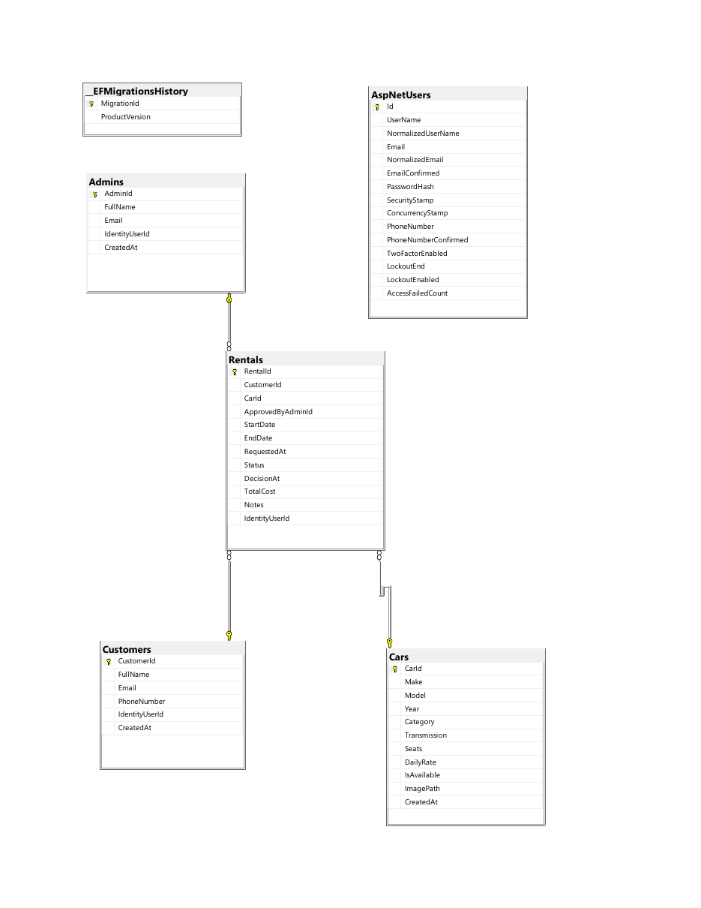

# Car Rental Management System

A web application for a car rental business, built with **ASP.NET Core MVC (.NET 10)**, **Entity Framework Core**, **SQL Server** and **ASP.NET Core Identity**. Customers browse cars and request rentals. Admins manage the fleet and approve, reject or complete each rental.

## Features

**Customers**
- Register and log in
- Browse the fleet with search and category filters
- Request a rental by choosing start and end dates; the total cost is calculated automatically
- Track each request's status on a **My Rentals** page

**Admins**
- Add, edit and delete cars, including uploading a photo for each one
- Review all rental requests and filter them by status
- Move each rental through the workflow **Pending → Approved / Rejected → Completed**; the approving admin and the decision time are recorded

## Security

- Authentication with **ASP.NET Core Identity**
- **Role-based authorization** with `[Authorize(Roles = "Admin")]` and `[Authorize(Roles = "Customer")]`, so customers can't reach admin pages
- **Anti-forgery tokens** (`[ValidateAntiForgeryToken]`) on every form that changes data
- Uploaded images are saved with a GUID prefix, so one upload can't overwrite another
- No passwords in the source code: the admin account is created from configuration (see below)

## Database design

The app uses the Identity tables for users and roles, plus its own `Cars`, `Customers`, `Admins` and `Rentals` tables. A customer or car can have many rentals, and each Identity user links to at most one customer or admin profile.



## Running it locally

You need the [.NET 10 SDK](https://dotnet.microsoft.com/download) and SQL Server LocalDB, which comes with Visual Studio.

1. Open `CarRentalManagementSystem.slnx` in Visual Studio.
2. Create the database. In the Package Manager Console, run:
   ```
   Update-Database
   ```
3. *(Optional)* Set up an admin account by setting two environment variables before you start the app. In PowerShell:
   ```powershell
   $env:SeedAdmin__Email = "admin@example.com"
   $env:SeedAdmin__Password = "ChooseAStrongPassword1!"
   ```
   When these are set, the app creates that account on startup and gives it the Admin role.
4. Press **Ctrl + F5** to run. Register a new account to use the customer side.

## Tech stack

ASP.NET Core MVC · C# · Entity Framework Core (code-first migrations) · SQL Server · ASP.NET Core Identity · Razor views · Bootstrap

## Possible next steps

- Block overlapping bookings for the same car
- Online payments
- An admin reporting dashboard
